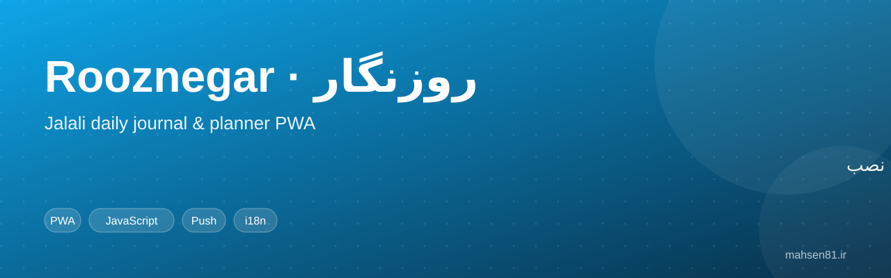

<!-- gen:header -->
<p align="center"></p>

<h1 align="center">Rooznegar · روزنگار</h1>
<p align="center"><b>دفترچه‌ی روزانه و برنامه‌ریز شمسی به‌صورت PWA قابل نصب</b><br><i>Jalali daily journal & planner PWA</i></p>
<p align="center">   </p>

<div dir="rtl">

## ✨ امکانات

- نصب روی گوشی مثل اپ
- اعلان یادآوری Push
- چندزبانه و RTL
- پشتیبان‌گیری و بازیابی

</div>

## 🚀 Quick start

```bash
Serve the folder over HTTPS (any static host) and open index.html.
```

---

<p align="center">ساخته‌شده توسط <a href="https://mahsen81.ir"><b>محسن جباره‌اصل</b></a> — برنامه‌نویسی، طراحی سایت، ربات و هوش مصنوعی<br>
Built by <a href="https://mahsen81.ir">Mohsen Jabbareh-Asl</a> · ⭐ اگر مفید بود، ستاره بدهید · Need a custom version? <a href="https://mahsen81.ir">Get in touch</a></p>
